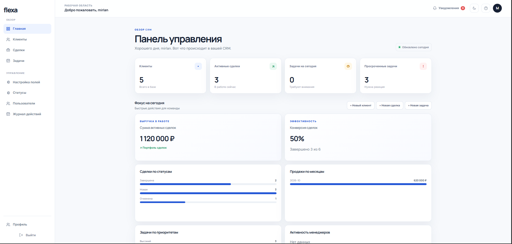
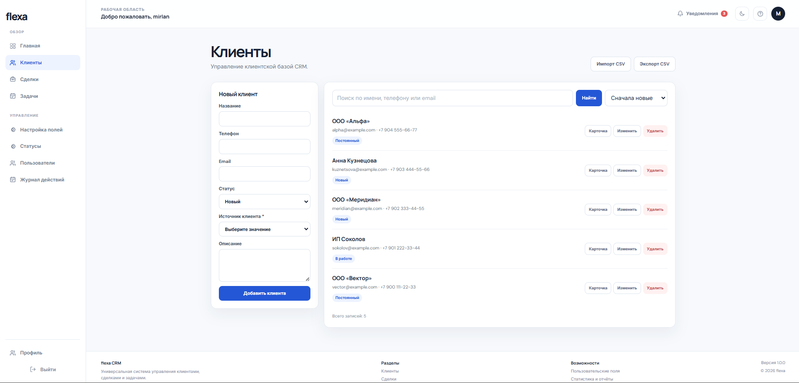
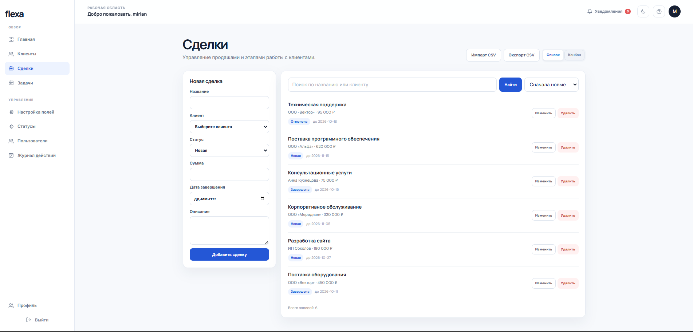

# CRM-система книжного магазина

Учебный проект практики: React + Django REST Framework + PostgreSQL.

## Интерфейс

Панель управления с ключевыми показателями CRM:



Работа с клиентской базой:



Сделки и их статусы:



## Структура

- `backend` — API, авторизация и бизнес-логика на Django.
- `frontend` — пользовательский интерфейс на React.

## Предметная область

Проект адаптирован под книжный магазин. Помимо общих разделов CRM, система содержит каталог книг, категории, цены и складские остатки. Заказ может включать несколько книг через позиции заказа.

## Первый день

Подготовлена базовая архитектура проекта и модуль пользователей с JWT-авторизацией.

## Запуск backend

1. Установить Python 3.11+ и PostgreSQL.
2. Создать виртуальное окружение:

```powershell
cd backend
python -m venv .venv
.\.venv\Scripts\Activate.ps1
pip install -r requirements.txt
```

3. Скопировать `.env.example` в `.env` и указать параметры PostgreSQL.
4. Выполнить миграции и запустить сервер:

```powershell
python manage.py migrate
python manage.py runserver
```

API будет доступен по адресу `http://127.0.0.1:8000/api/`.

## API клиентов

- `GET /api/clients/` — список клиентов;
- `GET /api/clients/?search=текст` — поиск по имени, телефону и email;
- `POST /api/clients/` — создание клиента;
- `PUT /api/clients/{id}/` — редактирование клиента;
- `DELETE /api/clients/{id}/` — удаление клиента;
- `GET /api/client-statuses/` — доступные статусы клиентов.
- `GET /api/deals/` — список сделок;
- `GET /api/deals/?search=текст` — поиск по названию сделки или клиенту;
- `POST /api/deals/` — создание сделки;
- `PUT /api/deals/{id}/` — редактирование сделки;
- `DELETE /api/deals/{id}/` — удаление сделки;
- `GET /api/deal-statuses/` — доступные статусы сделок.

## Каталог и заказы книжного магазина

- `GET /api/categories/` — список категорий книг;
- `POST /api/categories/` — создание категории для администратора или руководителя;
- `GET /api/books/` — каталог книг;
- `GET /api/books/?search=текст` — поиск по названию, автору и ISBN;
- `GET /api/books/?stock=low` — книги с низким остатком;
- `POST /api/books/` — добавление книги;
- `PUT /api/books/{id}/` и `DELETE /api/books/{id}/` — изменение и удаление книги;
- `GET /api/order-items/?deal={id}` — состав заказа;
- заказ из `/api/deals/` поддерживает поле `items` с книгами, количеством и ценой позиции;
- при создании или изменении заказа остаток книги проверяется и уменьшается;
- при отмене или удалении заказа зарезервированный остаток возвращается на склад.

## Интеграция с 1С

Интеграционные методы защищены заголовком `X-Integration-Key`. Ключ задаётся в `backend/.env` параметром `INTEGRATION_API_KEY`.

- `GET /api/integration/clients/` — выгрузка клиентов;
- `POST /api/integration/clients/` — добавление или обновление клиента по email;
- `GET /api/integration/books/` — выгрузка книг и остатков;
- `POST /api/integration/books/` — добавление или обновление книги по ISBN;
- `GET /api/integration/orders/` — выгрузка заказов;
- `POST /api/integration/orders/` — передача заказа из 1С;
- `PATCH /api/integration/orders/{id}/status/` — изменение статуса заказа.

Документация доступна по адресу `/api/docs/`, OpenAPI-схема — `/api/openapi.json`.

## Задачи, статистика и настройка

- `GET /api/tasks/` — список задач;
- `GET /api/tasks/?search=текст` — поиск по задаче, клиенту и сделке;
- `GET /api/tasks/?priority=high&due=overdue` — фильтрация по приоритету и сроку;
- `POST /api/tasks/` — создание задачи;
- `PUT /api/tasks/{id}/` и `DELETE /api/tasks/{id}/` — изменение и удаление;
- `GET /api/task-statuses/` — статусы задач;
- `GET /api/statuses/` — все статусы для страницы настройки;
- `POST /api/statuses/` — создание статуса администратором или руководителем;
- `PUT /api/statuses/{id}/` — редактирование статуса;
- `DELETE /api/statuses/{id}/` — удаление неиспользуемого статуса;
- `GET /api/custom-fields/?entity_type=client` — поля выбранного типа сущности;
- `POST /api/custom-fields/` — создание пользовательского поля для администратора или руководителя;
- `GET /api/dashboard/stats/` — сводная статистика CRM: статусы сделок, продажи по месяцам, приоритеты задач, активность менеджеров и конверсия;
- `GET /api/activity-log/` — журнал действий для администратора и руководителя;
- `GET /api/activity-log/?entity_type=client&action=create` — фильтрация журнала по объекту и действию.

Пользовательские значения хранятся в JSONB-поле `custom_data`, а описание полей — в таблице `customfield`. При сохранении API проверяет тип значения, обязательность и принадлежность ключа настроенным полям.

Списки клиентов, сделок, задач и журнала поддерживают параметры `page`, `page_size` и `ordering`. Ответ содержит `count`, `next`, `previous` и `results`.

## Безопасность

- JWT-авторизация с ограниченным временем жизни access- и refresh-токенов;
- автоматическое обновление access-токена при ответе API `401`;
- управление пользователями доступно администраторам по адресу `/api/auth/users/`;
- пароль не короче 8 символов и стандартные валидаторы Django;
- все рабочие API доступны только авторизованным пользователям;
- изменять запись может администратор, руководитель или назначенный ответственный;
- настройка пользовательских полей доступна только администратору и руководителю;
- настройка статусов доступна на странице `/statuses` только администратору и руководителю; статус можно сделать активным/неактивным и финальным;
- включены защитные HTTP-заголовки и throttling запросов.
- создание, изменение и удаление клиентов, сделок и задач записываются в `ActivityLog` вместе с пользователем, датой, описанием и IP-адресом;

## Роли

- `Администратор` — управление пользователями, ролями и всеми данными;
- `Руководитель` — просмотр пользователей, настройка полей и полный доступ к рабочим данным;
- `Менеджер` — создание и изменение назначенных ему клиентов и сделок;
- `Пользователь` — работа со своими задачами без управления ролями и настройками.

## Проверка

```powershell
cd backend
.\.venv\Scripts\python.exe manage.py check
.\.venv\Scripts\python.exe manage.py test crm_core
```

Все методы клиентов требуют JWT-токен в заголовке `Authorization: Bearer <token>`.

## Запуск frontend

```powershell
cd frontend
npm install
npm run dev
```

